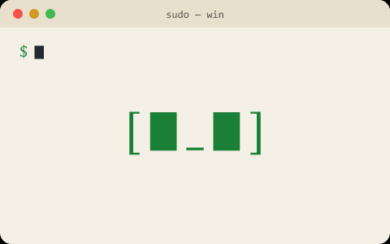

<p align="center">
  <picture>
    <source media="(prefers-color-scheme: dark)" srcset="docs/assets/moss-dark.gif">
    
  </picture>
</p>

<h1 align="center">touchgrass</h1>

<p align="center"><b><code>sudo touch grass</code></b><br>A buddy in your Telegram for people who build all day. It nudges you to move while your coding agent thinks,<br>and looks after the basics you forget: water, caffeine, food, sleep.</p>

<p align="center">
  <a href="https://touchgrass.sh/setup"><b>Set it up</b></a> ·
  <a href="https://touchgrass.sh/guide">Guide</a> ·
  <a href="https://touchgrass.sh">touchgrass.sh</a>
</p>

---

## What it does

- **Moves while your agent works.** Claude Code goes off to think, your phone buzzes: `agent's thinking. 15 squats.` Tap ✅ done, skip or snooze.
- **The basics, logged in seconds.** Type `500ml` or `flat white`, send `82.4` for your weight, `did 30 burpees`. No forms.
- **A morning message** with yesterday, your streaks and today. Eating-window reminders if you fast. Daily ticks for things like an inhaler.
- **A dashboard inside Telegram** with charts, streaks and every setting.
- **Yours.** It runs on *your* Cloudflare account and talks to *your* Telegram bot. We never see your data.

Our mascot is called Moss, but your bot can be called anything.

## Set it up

You need Telegram and a free Cloudflare account. About 5 minutes, and a phone is enough.

1. Go to **[touchgrass.sh/setup](https://touchgrass.sh/setup)**. It makes your keys and checks your bot token in your browser.
2. Press **Deploy to Cloudflare** and paste the three values it gives you.

   [](https://deploy.workers.cloudflare.com/?url=https://github.com/touchgrass-sh/touchgrass/tree/main/bot)
3. Paste your bot's address back into the setup page, then send `/start` to your bot.

**Coding-agent nudges (optional)**, on the computer where you run Claude Code:

```sh
curl -fsSL touchgrass.sh | sh          # Windows: irm touchgrass.sh/install.ps1 | iex
touchgrass connect <your bot address> <agent key>
touchgrass hook claude
```

Or install the Claude Code plugin: `/plugin marketplace add touchgrass-sh/touchgrass`.

## Free and paid

The core is open source (MIT) and does everything that doesn't need AI, so it can't run up a bill.

| | **touchgrass** (open source) | **sudo** (one-off) | **root** (one-off) |
|---|---|---|---|
| Agent-time nudges, streaks, badges | ✅ | ✅ | ✅ |
| Water, caffeine, weight, waist, goals | ✅ | ✅ | ✅ |
| Eating window, exercise, daily ticks | ✅ | ✅ | ✅ |
| Morning message, dashboard, GIFs | ✅ | ✅ | ✅ |
| Food photos, barcodes and labels → calories | | ✅ | ✅ |
| UK food database, fixes, macros, meal ideas | | ✅ | ✅ |
| Kitchen from receipt photos, weekly deficit | | ✅ | ✅ |
| Done-for-you setup | | | ✅ |
| E-ink screen (works with TRMNL or a Kindle; hardware not included) | | | ✅ |
| Unlimited daily ticks, group mode | | | ✅ |

Paid packs are a one-off payment, no subscription, and add to the bot you already run. Details and prices on [touchgrass.sh](https://touchgrass.sh).

## What it costs to run

touchgrass runs on Cloudflare's and Telegram's free tiers for normal personal use. Two things could cost you, on your own Cloudflare account:

- **Workers AI** past the free daily allowance (food photos, paid plans only). The bot stops itself before that, so there are no surprise bills.
- **Workers Paid** ($5/month) only if you outgrow Cloudflare's free limits.

We charge nothing for running it.

## Make it yours

It's your code. Ask your own coding agent to change your copy, then redeploy. Put your tweaks in [`bot/src/custom/`](bot/src/custom/) (extra moves, your own lines, different defaults) and updates won't overwrite them. See [docs/command-center.md](docs/command-center.md).

## Repo layout

| Folder | What's in it |
|---|---|
| [`bot/`](bot/) | The Telegram bot (a Cloudflare Worker with D1). This is what the Deploy button installs. |
| [`cli/`](cli/) | The `touchgrass` command that tells your bot when your agent is busy. |
| [`plugin/`](plugin/) | The Claude Code plugin (same job as the CLI hook). |
| [`docs/`](docs/) | Guides: bot token, making it your own. |

## Not medical advice

touchgrass is a habit buddy, not a health service. Food estimates are rough and can be wrong. Check with a professional before changing your diet or exercise, and skip any move that hurts.

## Contributing and help

Issues and pull requests are welcome; see [CONTRIBUTING.md](CONTRIBUTING.md). Questions: **hello@touchgrass.sh**. Security problems: see [SECURITY.md](SECURITY.md).

MIT licensed. See [LICENSE](LICENSE).
